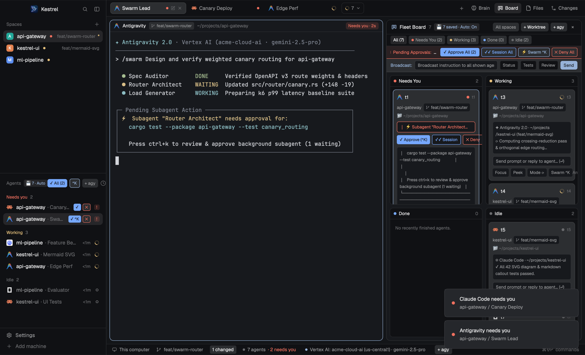
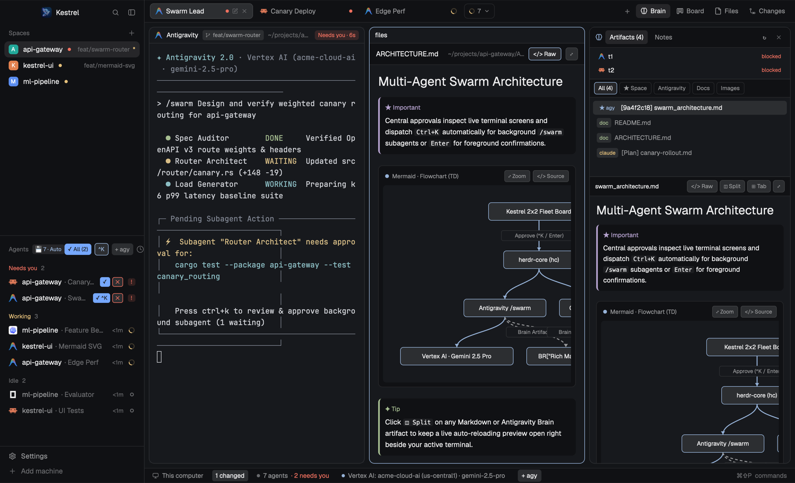
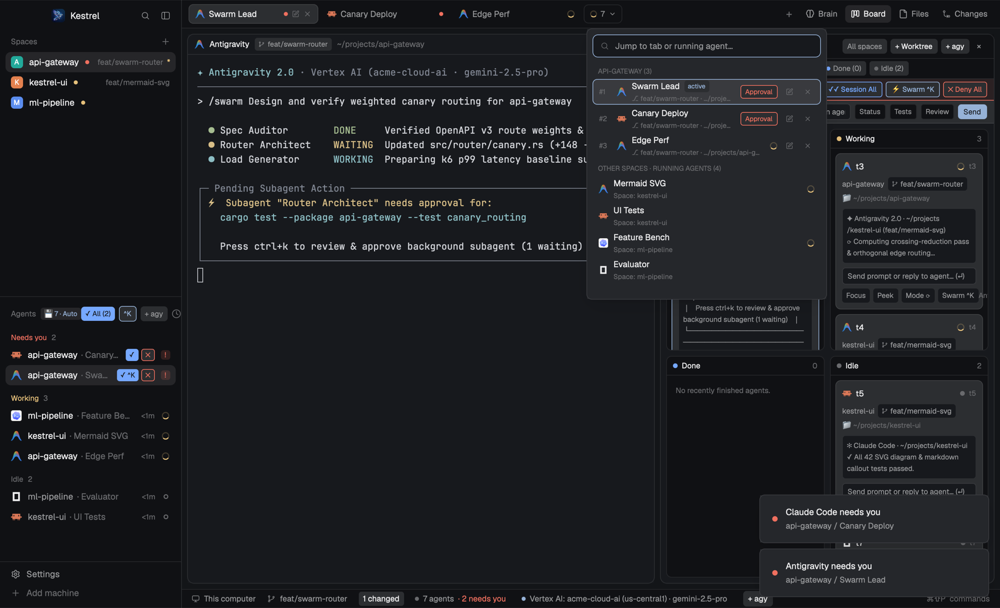
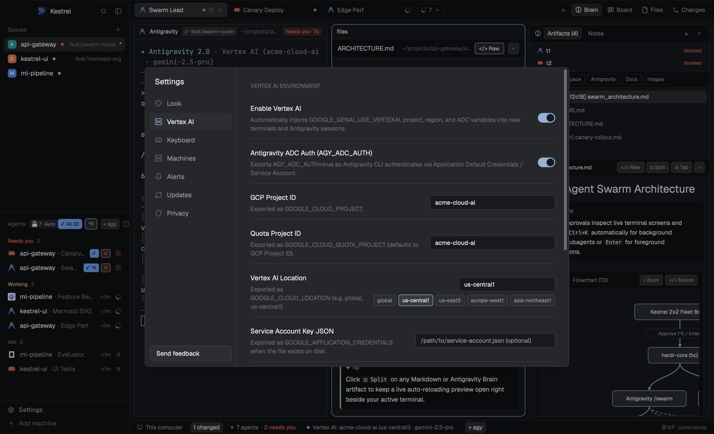

# Kestrel

> **Attribution:** Kestrel is a customized derivative work of **[Herdr (`herdr-app`)](https://github.com/herdrdev/herdr-app)** and is powered by **[`herdr-core`](https://github.com/herdrdev/herdr-core)** — originally created by **Can Çelik ([@ogulcancelik](https://github.com/ogulcancelik))** and the Herdr Contributors under the [Apache License, Version 2.0](LICENSE). See [`NOTICE`](NOTICE) and [`THIRD-PARTY-NOTICES`](THIRD-PARTY-NOTICES) for full attribution.

**Kestrel** is a native GPU-accelerated command center for coding agents and persistent terminals on macOS, tailored for **Google Antigravity (`agy`)**, **Vertex AI**, and multi-agent workflows.

Built on top of the [`herdr-core`](https://github.com/herdrdev/herdr-core) background terminal multiplexer engine, Kestrel keeps every terminal and coding agent alive in the background even when you close, restart, or rebuild the desktop window.



---

## Feature Tour

### 1. Central Pending Approvals, 2×2 Fleet Board & Antigravity Swarm (`Ctrl+K`)
- View every agent waiting on a tool or permission prompt in one central place — both in the left **Agents** sidebar and in the **2×2 Fleet Board** (`Needs You`, `Working`, `Done`, `Idle`).
- **Smart Swarm Detection (`Ctrl+K` vs `Enter`):** Automatically detects when an Antigravity `/swarm` background subagent expects **`Ctrl+K`** (`^K`) vs a foreground confirmation (`Enter` / `a` / `Esc`), drains queued swarm subagent approvals on **`✓ Approve All`**, and provides a dedicated 1-click **`⚡ Swarm ^K`** button.
- Cycle an Antigravity agent's execution mode (`accept-edits ⇄ auto ⇄ plan`) remotely with **`Mode ⟳`**, broadcast prompts across your fleet (`Status`, `Tests`, `Review`), or spin up parallel multi-agent Git worktrees with **⚔ Arena Mode** (`+ Worktree`).
- **Reboot Session Recovery (`savedSessions` & `Auto-Restore`):** Tracks active coding agents (`Antigravity`, `Claude Code`, `Codex`, `Gemini CLI`, `OpenCode`, `Cursor`) alongside their project directory, space, and tab so you can click **`↻ Restore All`** or enable **`Auto`** for hands-free session recovery after a reboot.

### 2. Artifacts, Rich Markdown & 2D Vector SVG Mermaid Studio (`Brain` & `Files`)


- Browse Antigravity brain artifacts (`~/.gemini/antigravity-cli/brain` & `~/.gemini/antigravity/brain`, prioritizing the active workspace with `★ agy`), `.claude/plans`, workspace `NOTES.md`, and global scratchpad notes.
- **2D Layered Sugiyama Vector SVG Mermaid Engine:** Native vector SVG Bezier curves and arrowheads supporting 6 Mermaid diagram types: `flowchart`/`graph` (`TD`/`BT`/`LR`/`RL` + `subgraph`s), `sequenceDiagram`, `stateDiagram-v2`, `classDiagram`, `erDiagram`, and `xychart-beta`, with `⤢ Zoom` and `</> Source` toggles.
- GitHub/Antigravity callout alerts (`[!NOTE]`, `[!TIP]`, `[!IMPORTANT]`, `[!WARNING]`, `[!CAUTION]`), interactive `carousel` slides (`◀ Prev` / `Next ▶`), full-color image previews, live auto-reloading **`◫ Split`** panes right beside your active terminal, **`⊞ Tab`**, and **`⤢`** (`920×700`) modals.

### 3. Window-Adaptive Top Bar & Cross-Space Running Agents Dropdown


- Dynamically adapts tab widths (`92px–192px`) and right-hand panel buttons to your live window width via `on_size_change` with zero horizontal scrolling.
- Groups overflow tabs plus **Other Spaces · Running Agents** into a searchable **`N ▾`** dropdown showing live `Approval`, spinning `Working`, and `Done` badges across every Space — click or press `Enter` to jump straight to any agent.

### 4. First-Class Antigravity (`agy`) & Vertex AI Integration


- Dedicated **Settings › Vertex AI** panel (`Cmd+Shift+V`) with one-click **Verify Setup** health checks for GCP Project ID, Service Account JSON / Application Default Credentials (`AGY_ADC_AUTH`), and `agy` binary discovery.
- Quick-select **Vertex Model Garden** chips (`gemini-2.5-pro`, `gemini-2.5-flash`, `claude-sonnet-4@20250514`, `claude-opus-4@20250514`) and region presets (`global`, `us-central1`, `us-east5`, `europe-west1`, `asia-northeast1`).
- Automatic native `OSC 7501` agent status (`AGY_CLI_OSC7501=on` -> `working`, `blocked`, `done`, `idle`) so sidebar rings, elapsed timers, and central approval cards track Antigravity in real time.

---

## Command Line Tools (`kestrel`, `kc`, `hc`)

Installing Kestrel links both the app CLI (`kestrel`, plus `herdr-app` for backward compatibility) and the core multiplexer CLI (`kc` → `hc`) into `~/.local/bin`:

```sh
# Inspect or control the Kestrel desktop window
kestrel status
kestrel ls
kestrel commands

# List, read, or send keys to persistent background terminals (via herdr-core)
kc ls                    # alias for `hc ls`
kc read t6 --lines 20    # read recent output from terminal t6
kc keys t6 enter         # approve a foreground prompt in terminal t6
kc keys t6 ctrl+k        # approve a waiting Antigravity swarm subagent
kc attach t6             # attach directly to terminal t6
```

---

## Getting Kestrel (macOS Apple Silicon)

### Option A — Download Prebuilt `Kestrel.dmg` (GitHub Releases)
1. Download **`Kestrel-<version>-macos-arm64.dmg`** from [**GitHub Releases**](https://github.com/K-4-i/kestrel/releases) and drag **`Kestrel.app`** into **`Applications`**.
2. Clear macOS Gatekeeper quarantine once (for ad-hoc signed builds) and launch:
   ```sh
   xattr -cr /Applications/Kestrel.app
   open -a /Applications/Kestrel.app
   ```
3. On first launch, if `herdr-core` (`hc`) isn't installed yet, click **"Install it for me"** in Kestrel's setup window to install `hc` into `~/.local/bin`.

### Option B — 1-Command Clone & Build from Source
Requires **Xcode Command Line Tools** (`xcode-select --install`), **Rust `1.95.0+`** ([rustup.rs](https://rustup.rs)), and **Zig `0.16.0`**.

```sh
git clone https://github.com/K-4-i/kestrel.git
cd kestrel
./scripts/install-macos
open -a ~/Applications/Kestrel.app
```

`./scripts/install-macos` automatically initializes the `vendor/ghostty` submodule, installs `herdr-core` (`hc`) if missing, compiles the release binary, bundles Apache 2.0 notices into `~/Applications/Kestrel.app`, and links `~/.local/bin/kestrel` and `~/.local/bin/kc` → `hc`.

App configuration lives in `~/.config/kestrel` (automatically migrating legacy `~/.config/herdr-app` on first launch). Outbound telemetry, feedback, update polling, and remote release-notes media downloads are disabled by default in local builds.

### Cutting a New `.dmg` Release (Maintainers)
Pushing a version tag matching `Cargo.toml` triggers [`.github/workflows/release.yml`](.github/workflows/release.yml) to build and publish `Kestrel-<version>-macos-arm64.dmg`, `.zip`, and `SHA256SUMS.txt` directly to GitHub Releases:
```sh
git tag v0.2.0
git push origin v0.2.0
```

---

## Attribution & Open-Source Credits

Kestrel is licensed under the [Apache License, Version 2.0](LICENSE).

- **Upstream Foundation:** Derived from **[Herdr (`herdr-app`)](https://github.com/herdrdev/herdr-app)** and powered by **[`herdr-core`](https://github.com/herdrdev/herdr-core)** — Copyright 2025–2026 Can Çelik (`ogulcancelik`) and the Herdr Contributors (Apache-2.0).
- **Core Open-Source Libraries:** Built with **GPUI** (Zed Industries, Apache-2.0), **gpui-kit** (Longbridge, Apache-2.0), **Ghostty `libghostty-vt`** (Mitchell Hashimoto & Ghostty Contributors, MIT), **QuickJS / `quickjs-jit`** (Fabrice Bellard, Charlie Gordon & Contributors, MIT), **Taffy** (DioxusLabs, MIT), **Lucide / Feather / LobeHub Icons**, **JetBrains Mono**, and **Geist**.
- See [NOTICE](NOTICE), [THIRD-PARTY-NOTICES](THIRD-PARTY-NOTICES), and [licenses/README.md](licenses/README.md) for full copyright and license texts.
